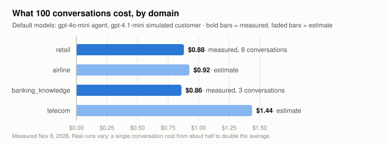

# tau-traffic

Generates realistic customer-support conversations for Tripwire to analyze, using
[τ-bench](https://github.com/sierra-research/tau2-bench) (Sierra's benchmark: a support
agent, an LLM-simulated customer, and a pass/fail grader). The agent's traces go to
Laminar, like a real app's would. Each run also writes an **answer key** (which
conversations passed or failed, and why) to check Tripwire's findings against.

Conversations can go out all at once, or **spread over time** (e.g. 40 over 8 hours),
so Tripwire's charts show traffic arriving the way it does in production.

## Requirements

- Linux or macOS
- git, and [uv](https://docs.astral.sh/uv/getting-started/installation/)
  (`curl -LsSf https://astral.sh/uv/install.sh | sh`)
- About 1.5 GB of disk (τ-bench's tasks and data)
- An OpenAI API key, and a Laminar project API key

## Setup (once)

```bash
traffic/tau-bench/setup.sh
```

It downloads τ-bench at the version we tested into `traffic/tau-bench/.tau2-bench/`
(git-ignored), installs its Python environment, and creates `traffic/tau-bench/.env`.
Put your two keys in `.env`. For self-hosted Laminar, also set the three `LMNR_` lines
there (they're explained in the file).

## Use

```bash
traffic/tau-bench/tau-traffic                 # wizard: asks everything, explains each choice
traffic/tau-bench/tau-traffic --help          # all flags
```

The wizard ends by printing the same run as a single command, so you can repeat it.
A few examples (from `traffic/tau-bench/`):

```bash
./tau-traffic --domain retail -n 3 --yes      # 3 conversations, now
./tau-traffic -n 40 --over 8h --yes           # 40 conversations, one every 12 minutes
./tau-traffic -n 40 --over 8h --dry-run       # just show the plan and cost estimate
./tau-traffic view runs/<run>                 # open a finished run in τ-bench's viewer
```

Domains: **retail** (online store), **airline**, **banking_knowledge** (the agent searches
698 policy documents, a RAG app), and **telecom** (hardest; the agent often struggles).

## What a run produces

Each run gets a folder in `traffic/tau-bench/runs/`, saved as each conversation finishes
(a crash or Ctrl+C keeps everything up to that point):

| File | What's in it |
|---|---|
| `answer_key.jsonl` | One line per conversation: Laminar session ID, task, passed or not, how it ended, cost |
| `summary.json` | Totals (pass rate, cost, how conversations ended) and the command to repeat the run |
| `transcripts.md` | Readable conversations, with every tool call and result |
| `results.json` | τ-bench's full records, including why the grader failed a conversation; open with `./tau-traffic view` |

**What Laminar receives** (default "turn" mode): one trace per customer message, grouped
into one session per conversation, with the agent's LLM calls and tool calls inside.
Every trace has `app_version` in its metadata. The simulated customer and the grader are
**never** traced: their prompts contain the expected answers.

## Costs



<!-- cost-tables:start -->
**Per conversation** (simulated customer: gpt-4.1-mini):

| Domain | agent gpt-4o-mini | agent gpt-4.1-mini | agent gpt-4.1 | Measured |
|---|---|---|---|---|
| retail | $0.009 | $0.014 | $0.060 | $0.009 (8 conversations, gpt-4o-mini) |
| airline | $0.009 | $0.014 | $0.060 | not yet |
| banking_knowledge | $0.008 | $0.013 | $0.054 | $0.009 (3 conversations, gpt-4o-mini) |
| telecom | $0.014 | $0.022 | $0.094 | not yet |

**Batches** (default models; measured where available):

| Domain | 10 conversations | 50 conversations | 100 conversations | 500 conversations |
|---|---|---|---|---|
| retail | $0.088 | $0.44 | $0.88 | $4.40 |
| airline (estimate) | $0.092 | $0.46 | $0.92 | $4.62 |
| banking_knowledge | $0.086 | $0.43 | $0.86 | $4.30 |
| telecom (estimate) | $0.14 | $0.72 | $1.44 | $7.19 |

**Spread over time, per day** (default models):

| Domain | one every 30 min (48/day) | one every 10 min (144/day) | one every 2 min (720/day) |
|---|---|---|---|
| retail | $0.42 | $1.27 | $6.34 |
| airline (estimate) | $0.44 | $1.33 | $6.66 |
| banking_knowledge | $0.41 | $1.24 | $6.19 |
| telecom (estimate) | $0.69 | $2.07 | $10.35 |
<!-- cost-tables:end -->

- Most of the cost is the support agent: it re-reads its policy and tool list on every
  step and takes 10–25 steps per conversation. Single conversations range from about half
  to double the average.
- The default **budget is $1.00 per run**. The plan warns when the estimate is higher;
  raise it with `--budget` (or in the wizard's advanced settings).
- To update these numbers after more runs: edit `MEASURED` in `cost_guide.py` (and
  `TOKEN_PROFILES` in `tau_traffic.py` if estimates drift), then run `python3 cost_guide.py`.

## Good to know

- **Many conversations fail, even with no bugs.** τ-bench grades strictly (the final
  database must match exactly), and the default agent, gpt-4o-mini, is a small model: in
  our first retail runs 3 of 8 passed. The failures are real agent mistakes, often silent
  (the customer leaves happy with a wrong result), which is exactly what Tripwire is for.
- **Stopping a run:** Ctrl+C once stops new conversations and lets running ones finish;
  twice saves immediately and quits.
- **Long runs** keep the computer awake by default (Linux: `systemd-inhibit`, macOS:
  `caffeinate`). If it sleeps anyway, the run pauses and continues on waking, without a
  burst of missed conversations.
- **Loop guards** (on by default): a simulated customer repeating itself ends the
  conversation; an agent repeating the same tool call 3 times in one turn gets a fallback
  reply ("Sorry, I'm having trouble looking that up…"), like a real app's tool-call cap.
- **Run labels** stay local unless you choose to send them to Laminar. Don't put bug names
  or expected results in a label you send.
- Already have τ-bench somewhere? Set `TAU2_BENCH_DIR` in `.env` and run `setup.sh`.

## Test checklist

- [ ] `setup.sh` on a fresh clone finishes and creates `.env`
- [ ] `./tau-traffic --domain retail -n 2 --yes`: 2 conversations; Laminar shows 2 sessions
      with one trace per customer message
- [ ] The printed `./tau-traffic view runs/<run>` opens the run
- [ ] `./tau-traffic -n 3 --over 6m --yes`: conversations start 2 minutes apart
